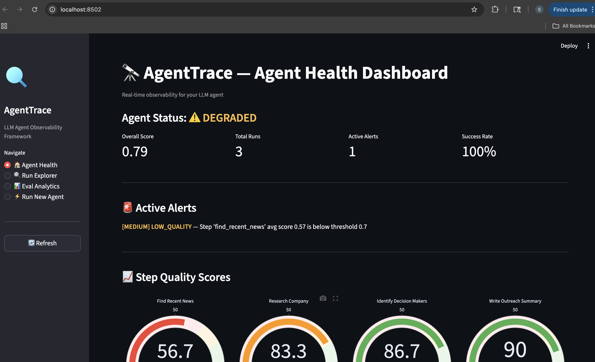
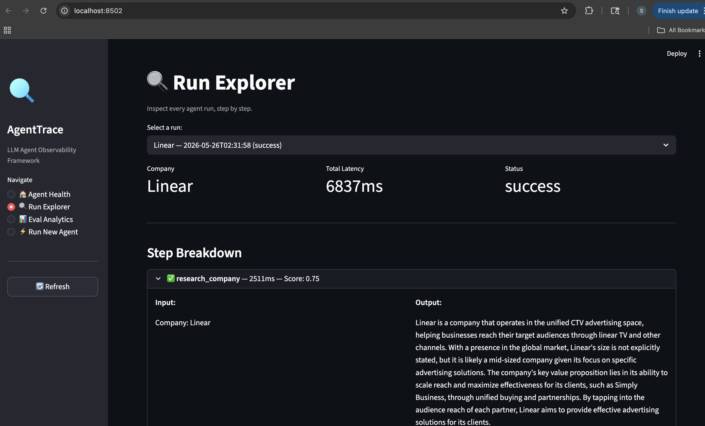
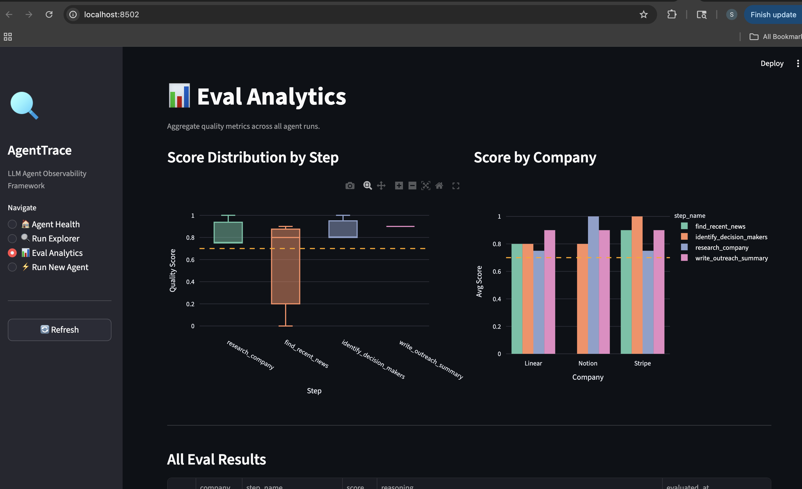
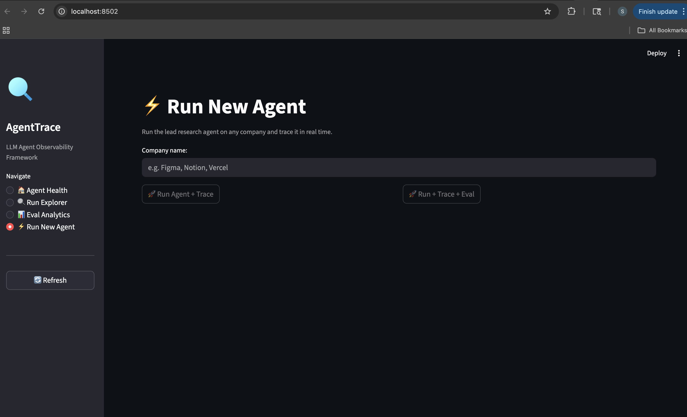

# AgentTrace — LLM Agent Observability Framework

**Live Demo:** https://agenttrace-by-sakshi.streamlit.app

> Companies deploy LLM agents and they break silently. No evals, no monitoring, no alerts. AgentTrace is the observability layer that fixes that.

---

## The Problem This Solves

Teams ship LLM-powered workflows — collections agents, research agents, onboarding bots — and they work in the demo. Three weeks later they're hallucinating, skipping steps, or producing low-quality outputs. Nobody notices until outcomes stop improving.

There are no evals. No monitoring. No alerts. The agent just silently degrades.

This is one of the most painful live problems in production AI right now. AgentTrace wraps any LLM agent, traces every step, scores output quality automatically using LLM-as-judge, and alerts when quality drops below threshold.

---

## What AgentTrace Does

- **Step-level tracing** — every agent step logged with input, output, latency, token estimates
- **LLM-as-judge evals** — automatic quality scoring after each run, no human labeling needed
- **Drift detection** — compares recent scores to historical baseline, alerts on degradation
- **Real-time dashboard** — agent health status, per-step gauges, score trends, active alerts
- **Run explorer** — inspect every run step by step, see exactly what the agent produced and why it scored what it scored
- **Eval analytics** — aggregate quality metrics across all runs, score distribution by step and company

---

## Screenshots

### Agent Health Dashboard

*Overall agent status (Healthy/Degraded/Critical), per-step quality gauges, active alerts, and score trend over time. The `find_recent_news` step scored 0.57 avg — below the 0.70 threshold — triggering a MEDIUM alert automatically.*

---

### Run Explorer

*Inspect any run step by step. See the exact input and output for each step, latency, eval score, and the LLM judge's reasoning.*

---

### Eval Analytics

*Score distribution box plots per step, grouped bar chart comparing quality across companies, orange dashed alert threshold at 0.70.*

---

### Run New Agent

*Run the agent against any company. Choose "Run + Trace" or "Run + Trace + Eval" to automatically score output quality after the run.*

---

## Architecture
Company Name (input)
→ Lead Research Agent (LangGraph, 4 steps)
→ research_company
→ find_recent_news
→ identify_decision_makers
→ write_outreach_summary
→ RunTracer (wraps entire run)
→ StepTracer (wraps each node)
→ SQLite (stores runs, steps, evals)
→ LLM-as-Judge Evaluator (Groq)
→ Per-step scoring criteria
→ Score + reasoning logged
→ Drift Detector
→ Compares recent vs historical
→ Fires alerts on degradation
→ Streamlit Dashboard (4 pages)

---

## Tech Stack

| Layer | Tech |
|---|---|
| Agent framework | LangGraph |
| LLM | Groq API (llama-3.3-70b) — free tier |
| Web search | DuckDuckGo (ddgs) — free, no API key |
| Tracing storage | SQLite |
| LLM-as-judge | Groq (same key) |
| Dashboard | Streamlit + Plotly |

**Total infrastructure cost: $0**

---

## Running Locally

```bash
# 1. Clone and set up
git clone https://github.com/Sakshi3027/agenttrace.git
cd agenttrace
python -m venv venv && source venv/bin/activate
pip install langgraph langchain langchain-groq ddgs streamlit plotly pandas httpx python-dotenv

# 2. Set Groq API key (free at console.groq.com)
export GROQ_API_KEY=your_key_here

# 3. Run the traced agent (generates initial data)
python -m agent.traced_agent

# 4. Run evals on the traces
python -m tracer.evaluator

# 5. Start the dashboard
streamlit run dashboard/app.py --server.port 8502
```

Open `localhost:8502` to see the dashboard.

---

## Project Structure
agenttrace/
├── agent/
│   ├── config.py           # Groq config
│   ├── lead_agent.py       # LangGraph agent (4 steps)
│   └── traced_agent.py     # Agent + tracing wrapper
├── tracer/
│   ├── trace_db.py         # SQLite schema + queries
│   ├── tracer.py           # RunTracer + StepTracer
│   ├── evaluator.py        # LLM-as-judge eval layer
│   └── drift.py            # Drift detection + alerting
├── dashboard/
│   └── app.py              # Streamlit dashboard (4 pages)
└── assets/
└── screenshots/

---

## The FDE Angle

This project demonstrates the exact capability FDEs get pulled into constantly at AI companies:

A customer deploys an LLM agent. It works in the demo. 3 weeks later outcomes have degraded. Nobody knows why. The FDE gets called in.

AgentTrace is what you deploy in that situation — wrap the existing agent, instrument every step, run evals, find the degraded step, show the customer exactly what broke and when.

The `find_recent_news` step in this demo scored 0.57 average — below the 0.70 alert threshold. The dashboard caught it automatically. That's the value proposition.

---

## Author

**Sakshi Chavan** — Data Scientist & Software Engineer
[GitHub](https://github.com/Sakshi3027) | [EduPulse](https://huggingface.co/spaces/Sakshi3027/edupulse) | [Email](mailto:sakshchavan30@gmail.com)
